## העיקרון: שלושה מרכיבים

ב-**HeyGen** אווטאר בנוי משלושה מרכיבים: **מראה** (**Appearance**), **תנועה** (**Motion**) ו**קול** (**Voice**). ככל שהחומר שתספקו בכל אחד מהם יהיה טוב יותר, כך האווטאר ייראה ויישמע אמיתי יותר.

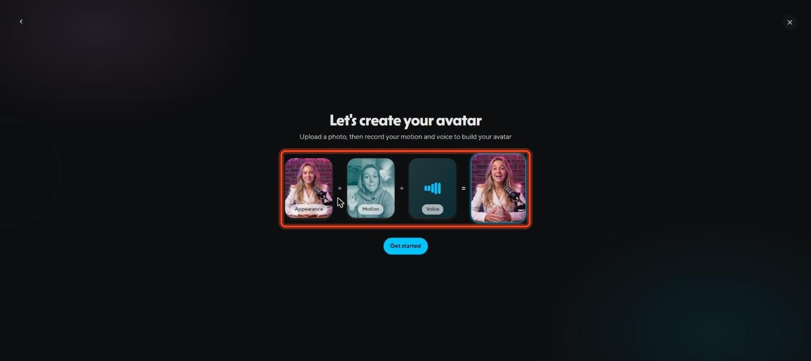

## לפני שפותחים את התוכנה

השלב הראשון קורה מחוץ למערכת: הכנת החומרים. מהניסיון שלי, זה השלב שמשפיע על התוצאה יותר מכל דבר אחר.

### תמונות

- תמונות סלפי שבהן הפנים נראות בבירור
- מכמה זוויות
- כמה הבעות: חיוך קטן, הבעה רצינית, פה מעט פתוח

### סרטונים

- 2-3 סרטונים שבהם אתם מדברים מול המצלמה
- טקסט ארוך, עם מגוון רגשות
- תואמים לתמונות

### הקלטת קול

- במקום שקט
- דיבור ברור, שנשמע היטב
- עם רגש ועם ביטחון

> הכלל החשוב ביותר: אותו מקום ואותו סטאפ בכל החומרים. לדוגמה, מול המצלמה, כשמאחור פינת המחשב.

## השלבים בתוכנה

### צעד 1: נכנסים ל-HeyGen ופותחים את Avatar

בתפריט הצד, בצד שמאל של המסך, נמצא הכפתור **Avatar**. שם מרוכז כל מה שקשור לאווטאר שלכם.

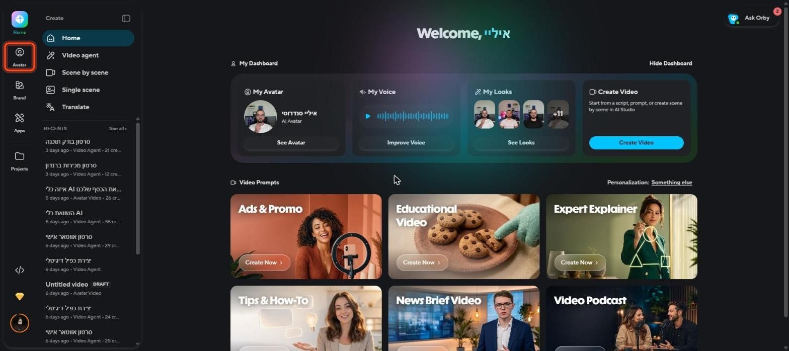

### צעד 2: לוחצים על New Avatar

הכפתור הכחול בפינה הימנית העליונה פותח את תהליך היצירה.

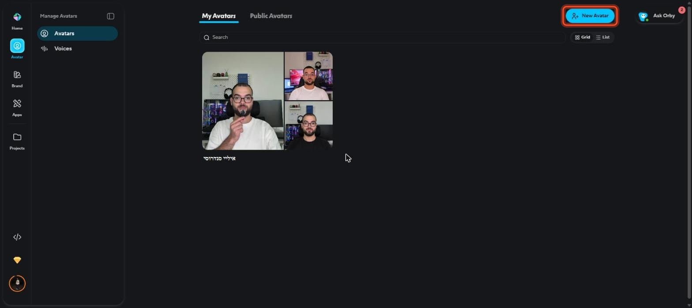

### צעד 3: בוחרים Myself

המערכת מציעה שתי אפשרויות. **Myself** יוצרת אווטאר שנראה, זז ונשמע כמוכם, וזו האפשרות שאנחנו צריכים.

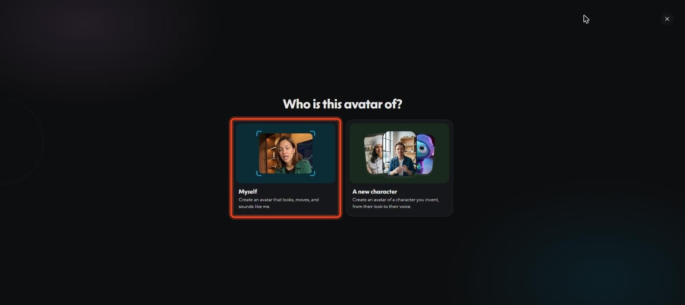

### צעד 4: מראה: מעלים תמונה

לוחצים על **Upload your favorite photo** ובוחרים את התמונה הטובה ביותר שלכם. את שאר התמונות מוסיפים בהמשך, בלשונית **Looks**.

- תמונת סלפי שבה הפנים נראות בבירור
- צילום מכמה זוויות
- כמה הבעות פנים: חיוך קטן, הבעה רצינית, פה מעט פתוח
- רצוי לצלם במקום שבו תצטלמו באופן קבוע

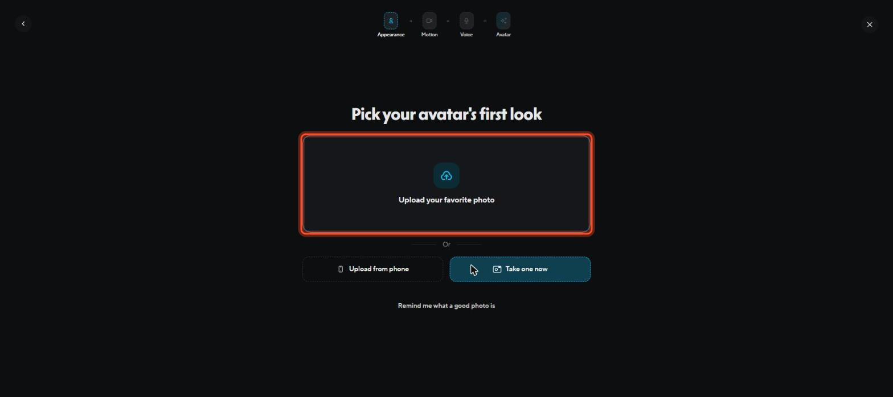

### צעד 5: תנועה: מעלים סרטונים שבהם אתם מדברים

לוחצים על **Upload footage** ומעלים סרטון. אפשר גם לצלם ישירות מהמחשב (**Record your motion**) או מהטלפון (**Record on phone**).

- 2-3 סרטונים שבהם אתם מדברים מול המצלמה
- טקסט ארוך, שמעביר אתכם דרך מגוון רגשות
- כך המערכת לומדת איך אתם זזים במצבים שונים
- באותו מקום ובאותו סטאפ כמו בתמונות

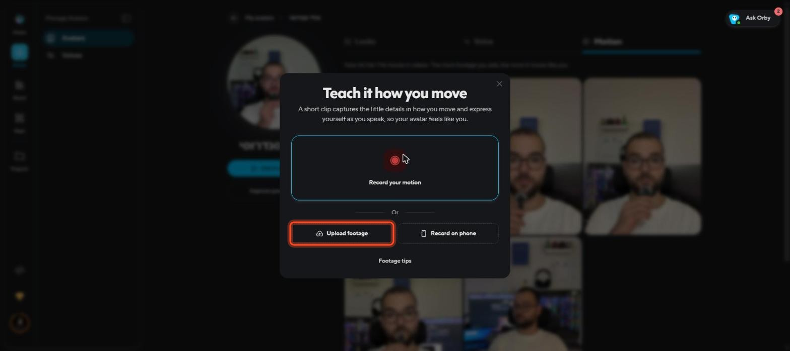

*צילום המסך לקוח מהאווטאר הקיים שלי. ביצירה הראשונה המסך הזה מופיע מיד אחרי העלאת התמונה.*

### צעד 6: קול: מקליטים את עצמכם מדברים

זה השלב האחרון. אחרי שהקול נוצר, נכנסים ללשונית **Voice**, לוחצים על **Improve voice**, ובוחרים בשפה **Hebrew** ובמנוע הקול **ElevenLabs**. זו ההגדרה שאני עובד איתה, ואני ממליץ עליה.

- הקלטה במקום שקט
- דיבור ברור, שנשמע היטב
- לדבר עם רגש ועם ביטחון

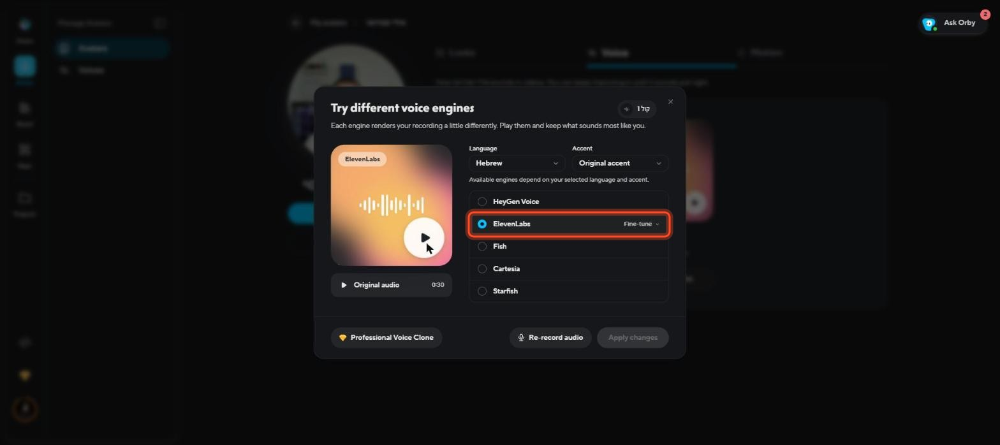

## כך זה נראה אצלי

אחרי שהאווטאר נוצר, בעמוד שלו מופיעות שלוש לשוניות. בכל אחת מהן אפשר להוסיף חומר ולשפר את התוצאה לאורך זמן.

### Looks: המראות שלי

כאן מרוכזים כל המראות של האווטאר. הכפתור **New look** מוסיף מראה חדש.

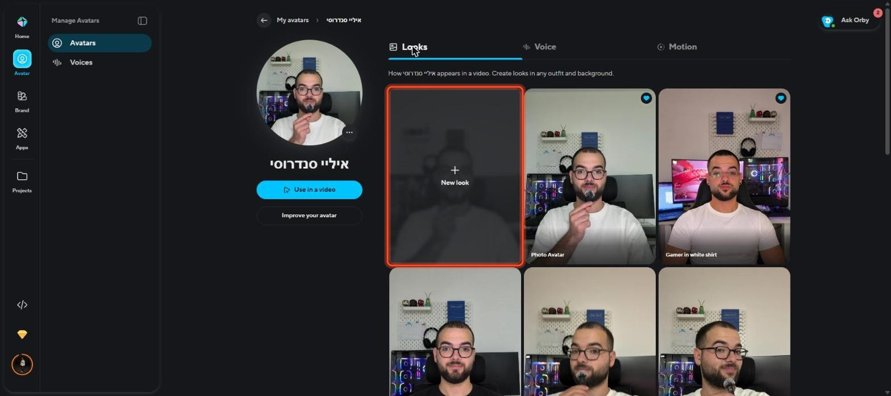

### Motion: סרטוני התנועה שלי

העליתי ארבעה סרטונים. הכפתור **Add more training motion** מוסיף סרטונים נוספים. ככל שיש יותר חומר, כך האווטאר זז באופן דומה יותר אליכם.

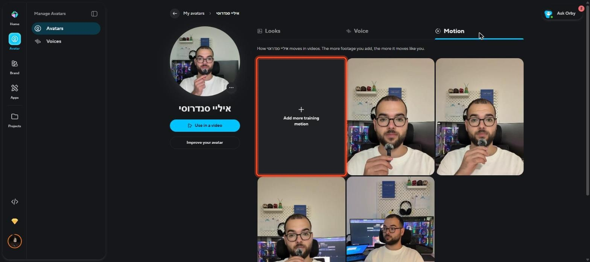

### Voice: הקול שלי

כאן מאזינים לקול, והכפתור **Improve voice** פותח את בחירת מנוע הקול.

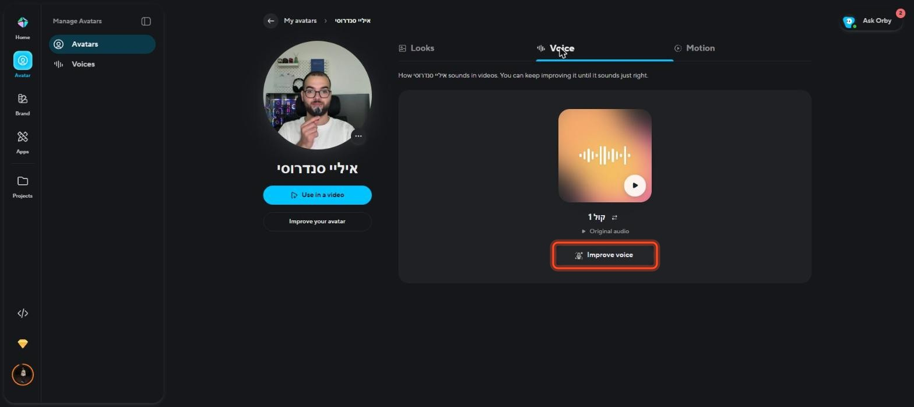

## יוצרים סרטון: שתי שיטות

כשהאווטאר מוכן, חוזרים ל-**Home**. בתפריט מופיעות שתי דרכים ליצור סרטון.

### שיטה 1: Video agent

כותבים רעיון או מדביקים תסריט, והמערכת בונה את הסרטון. בחלק העליון אפשר לראות שהאווטאר והקול שלכם כבר נבחרו.

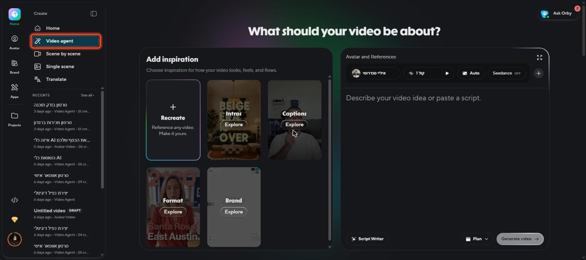

### שיטה 2: Scene by scene

בונים את הסרטון בעצמכם, סצנה אחרי סצנה. אפשר להתחיל מסרטון ריק או מתבנית מוכנה.

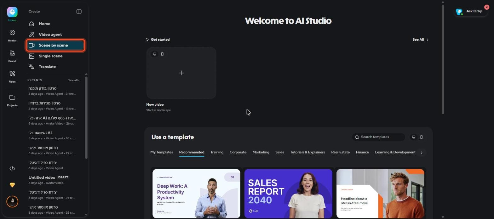

> אני עובד עם **Video agent**. ההמלצה שלי: נסו את שתי השיטות, ובחרו את זו שנוחה לכם יותר.

## טיפים ממשתמשים אחרים

בנוסף לניסיון שלי, עברתי על דיונים של משתמשי **HeyGen** בפורומים ועל מרכז העזרה הרשמי, ואספתי את העצות שחוזרות שם שוב ושוב. הן אינן מהניסיון האישי שלי, אבל הן מתיישבות היטב עם מה שראיתי בעבודה שלי.

### איכות חומר הגלם קובעת

זו הנקודה שחוזרת הכי הרבה: תאורה אחידה, רקע נקי, פנים ברורות וצילום באיכות גבוהה. מה שנכנס למערכת הוא מה שיוצא ממנה.

### מה שעושים בסרטון, האווטאר ישחזר

מחווה שחוזרת פעמיים, מבט שבורח הצידה או חיוך: האווטאר ישתמש בהם שוב ושוב. לכן מסתכלים למצלמה ומגוונים בתנועות.

### אנרגיה, אבל בלי לזוז מהמקום

דיבור שטוח מייצר אווטאר שנראה רובוטי. כדאי להיות מעט יותר אנרגטיים מהרגיל בפנים ובקול, ולהישאר יציבים במרכז הפריים.

### צילום אחד רציף

סרטון התנועה צריך להיות שוט אחד, בלי חיתוכים ובלי החלפת סצנה, כשהפנים נראות לכל אורכו.

### רעשי רקע נשארים

רעש שנקלט בהקלטה המקורית עלול ללוות את האווטאר בכל סרטון שייווצר אחר כך. מקליטים בחדר שקט.

### תסריט במשפטים קצרים

משפטים קצרים ומדוברים נשמעים טבעיים יותר ממשפטים ארוכים ומלוטשים. קוראים את התסריט בקול לפני שיוצרים. פסיקים ונקודות קובעים את הקצב וההפסקות.

### מתחילים בקטן

לפני סרטון ארוך בודקים טקסט קצר, ומאזינים לתצוגה המקדימה של הקול לפני היצירה. כל יצירה צורכת קרדיטים, וכך לא מבזבזים אותם על ניסיונות.

### סרטונים קצרים, רעיון אחד בכל סצנה

בסרטונים ארוכים תנועות חוזרות נעשות בולטות. עדיף לחלק את התוכן לסצנות קצרות, כשכל סצנה עוסקת ברעיון אחד.

**מקורות:**

- דיונים בקהילת [r/heygen](https://www.reddit.com/r/heygen/) וב-[r/generativeAI](https://www.reddit.com/r/generativeAI/comments/1qfb769/has_anyone_used_heygens_photo_avatar_ai_video/) ב-Reddit, כולל תשובות של צוות HeyGen
- מרכז העזרה של HeyGen: [Avatar & Voice FAQ](https://help.heygen.com/en/articles/15544929-avatar-voice-faq-troubleshooting-best-practices-and-credits)

## רשימת בדיקה לפני שמתחילים

- [ ] בחרתי מקום צילום אחד, ואני נשאר בו
- [ ] יש לי תמונות סלפי מכמה זוויות ועם כמה הבעות
- [ ] צילמתי 2-3 סרטונים שבהם אני מדבר, עם טקסט ארוך ומגוון רגשות
- [ ] כל סרטון הוא צילום אחד רציף, ואני מסתכל למצלמה
- [ ] יש לי מקום שקט להקלטת הקול
- [ ] במנוע הקול בחרתי **Hebrew** ו-**ElevenLabs**
- [ ] את הסרטון הראשון אני מתחיל בטקסט קצר
